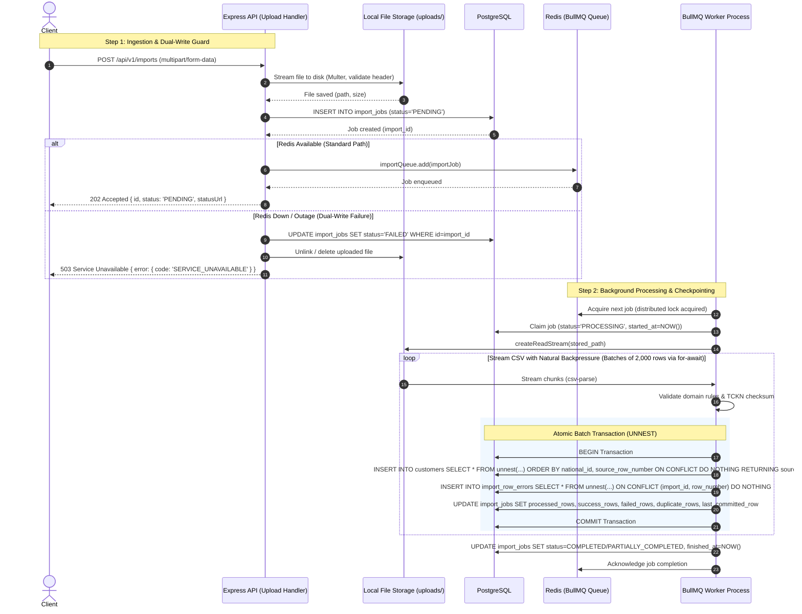
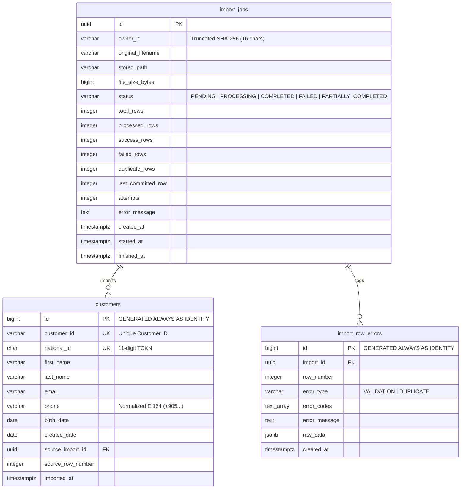

# System Architecture Documentation

## 1. System Overview & Context

The **High-Volume Customer CSV Ingestion Service** is an asynchronous microservice engineered to process large customer CSV files (tested up to 1,000,000 records) with strictly bounded memory utilization, transactional integrity, and resilient crash recovery.

### High-Level Requirements & Guarantees

- **Throughput**: Processes up to 1,000,000 records in under 60 seconds (>20,000 rows/second).
- **Constant Memory Footprint**: Ingests arbitrarily sized files within a 512 MiB container limit using Node.js stream backpressure. Live container worker consumes only **≈52 MiB peak RAM** (sampled via `docker stats` under a 512 MiB cgroup ceiling).
- **Data Integrity & Deduplication**: Database-enforced deduplication via target-less `ON CONFLICT DO NOTHING` handling unique constraints across both `customer_id` and `national_id`.
- **Resilience**: Transactional batch checkpointing allows transparent recovery from the last committed row without double-insertions.

---

## 2. Decoupled Architecture & Sequence Flow

The application decouples HTTP file ingestion from the CPU/IO-heavy parsing and database insertion pipeline using an asynchronous message queue (BullMQ backed by Redis).

### End-to-End Ingestion Flow (Mermaid Sequence)



---

## 3. Domain Model & Database Schema

The persistence layer uses raw SQL migrations executed via `node-pg-migrate`. Tables are strictly normalized and indexed for high-volume batch operations and cursor pagination.

### Entity-Relationship Diagram (Mermaid ER)



### Indexing Strategy & EXPLAIN Performance

1. **`customers` Unique Constraints (`uq_customers_customer_id`, `uq_customers_national_id`)**:
   - Two distinct unique B-Tree indexes. Enables atomic deduplication via target-less `ON CONFLICT DO NOTHING`.
   - Benchmark verification: Unique constraint lookup executes in **0.029 ms**.
2. **`import_row_errors(import_id, row_number)` (Composite Unique B-Tree `uq_import_row_errors_import_row`)**:
   - Powers deterministic Keyset (cursor) pagination.
   - Benchmark verification: Index leaf seek executes in **0.116 ms**, completely eliminating sequential table scans.
3. **`import_jobs(owner_id, created_at DESC)` (Composite B-Tree `idx_import_jobs_owner_created_at`)**:
   - Powers IDOR-isolated paginated job history (`GET /api/v1/imports`).

---

## 4. Clean Architecture Layers

The codebase adheres strictly to Clean Architecture principles, ensuring clear separation of concerns across domain rules, application orchestration, and infrastructure implementations.

```text
               ┌────────────────────────────────────────────────────────┐
               │                   Presentation / API                   │
               │   (Express Controllers, Middlewares, Routes, Swagger)  │
               └───────────────────────────┬────────────────────────────┘
                                           │
               ┌───────────────────────────▼────────────────────────────┐
               │                   Application Layer                    │
               │  (ImportService, ImportProcessorService, ReportService)│
               │  [Ports: Repositories, Queue, Storage Interfaces]      │
               └───────────────────────────┬────────────────────────────┘
                                           │
               ┌───────────────────────────▼────────────────────────────┐
               │                     Domain Layer                       │
               │  (Customer Rules, TCKN Checksum, Status Resolver)      │
               │  [PURE BUSINESS LOGIC - ZERO I/O]                      │
               └────────────────────────────────────────────────────────┘
                                           ▲
                                           │ (Implements Ports)
               ┌───────────────────────────┴────────────────────────────┐
               │                  Infrastructure Layer                  │
               │  (pg Pool, BullMQ, Redis, Local File Storage)          │
               └───────────────────────────┘
```

1. **Domain Layer (`src/domain/`)**: Pure business logic with **Zero I/O operations**. Contains the Republic of Turkey TCKN checksum algorithm, date validation rules, status resolution logic, and CSV formula sanitization. _(Note: `header-parser.ts` uses synchronous in-memory parsing via `csv-parse/sync` without filesystem I/O)._
2. **Application Layer (`src/application/`)**: Coordinates use cases (`ImportService`, `ImportProcessorService`, `ReportService`) and defines port contracts (`ImportRepositoryPort`, `ImportQueuePort`, `FileStoragePort`, `ReportRepositoryPort`).
3. **Infrastructure Layer (`src/infrastructure/`)**: Implements application ports using PostgreSQL (`pg`), Redis (`ioredis`, `bullmq`), and filesystem storage.
4. **API Layer (`src/api/`)**: Express controllers, multipart streaming upload middleware, authentication middleware, keyset pagination formatting, and global error handling. Wired manually via `container.ts` (Manual Dependency Injection).

---

## 5. Core Technical Decisions & Discarded Alternatives

### 1. Redis / BullMQ vs. PostgreSQL `FOR UPDATE SKIP LOCKED`

- **Selected**: **BullMQ backed by Redis (`appendonly yes`)**.
- **Rationale**:
  - Provides distributed locking with automatic heartbeat renewal (`lockDuration`), preventing split-brain execution across multiple workers.
  - Stalled job recovery: If a worker process abruptly dies, its heartbeat ceases. Once `lockDuration` expires, BullMQ marks the job as stalled and re-queues it for execution.
  - Offloads queue polling and progress events from PostgreSQL, reserving database connection pools and I/O exclusively for batch data ingestion.
- **Discarded Alternative (PostgreSQL `FOR UPDATE SKIP LOCKED`)**:
  - Polling a relational database under heavy bulk ingestion creates lock contention and connection pool exhaustion. Detecting crashed workers also requires custom heartbeat watchdog mechanisms.

---

### 2. Native `pg` Raw SQL vs. Prisma / TypeORM

- **Selected**: **Native `pg` Pool with parameterized raw SQL**.
- **Rationale**:
  - **Memory Footprint**: ORMs instantiate full TypeScript object models (hydration) for every row, bloating V8 heap memory when handling 2,000-record batches.
  - **PostgreSQL Control**: Direct control over `UNNEST` array parameters, transaction boundaries, and raw connection release without middleware overhead.
- **Discarded Alternative (ORMs)**:
  - While Prisma supports `$queryRaw`, using an ORM for high-throughput batch ingestion introduces abstraction layers without performance benefits while complicating connection pool tuning.

---

### 3. PostgreSQL `UNNEST` vs. `COPY`

- **Selected**: **Multi-column `UNNEST` with target-less `ON CONFLICT DO NOTHING`**.
- **SQL Implementation** (`src/infrastructure/repositories/pg-import.repository.ts`):
  ```sql
  INSERT INTO customers (
    customer_id, national_id, first_name, last_name, email, phone,
    birth_date, created_date, source_import_id, source_row_number
  )
  SELECT * FROM unnest(
    $1::varchar[], $2::char(11)[], $3::varchar[], $4::varchar[],
    $5::varchar[], $6::varchar[], $7::date[], $8::date[],
    $9::uuid[], $10::int[]
  ) AS t(customer_id, national_id, first_name, last_name, email, phone, birth_date, created_date, source_import_id, source_row_number)
  ORDER BY national_id, source_row_number
  ON CONFLICT DO NOTHING
  RETURNING source_row_number;
  ```
- **Rationale**:
  - **Atomic Deduplication Across Multiple Constraints**: The `customers` table has two separate unique constraints (`uq_customers_customer_id` and `uq_customers_national_id`). A target-less `ON CONFLICT DO NOTHING` catches duplicate violations on **either** column. If a specific target like `(national_id)` were provided, a `customer_id` collision would throw an unhandled `23505` unique violation error and abort the batch.
  - **Zero Intermediate Storage**: Detects inserted vs. conflicting rows atomically using `RETURNING source_row_number` without temporary staging tables.
- **Discarded Alternative (`COPY FROM STDIN`)**:
  - `COPY` does not support `ON CONFLICT`. Utilizing `COPY` would require streaming rows into a temporary staging table, executing an `INSERT INTO ... SELECT ... ON CONFLICT`, and dropping the staging table.

---

### 4. Keyset (Cursor) Pagination vs. `OFFSET`

- **Selected**: **Keyset pagination based on `row_number`**.
- **SQL Implementation** (`src/infrastructure/repositories/pg-report.repository.ts`):
  ```sql
  SELECT id, import_id, row_number, error_type, error_codes, error_message, raw_data, created_at
  FROM import_row_errors
  WHERE import_id = $1
    AND ($2::int IS NULL OR row_number > $2)
    AND ($3::varchar IS NULL OR error_type = $3)
  ORDER BY row_number ASC
  LIMIT $4; -- Queries limit + 1 to compute has_more
  ```
- **Rationale**:
  - **O(log n) B-Tree Seek**: Leveraging the composite unique index `uq_import_row_errors_import_row`, PostgreSQL seeks directly to the target leaf node in **0.116 ms** (total query execution in 0.158 ms, measured on isolated B-Tree keyset seek), completely independent of page depth.
- **Discarded Alternative (`OFFSET / LIMIT`)**:
  - `OFFSET N` forces PostgreSQL to sequentially scan and discard the first N rows (O(n) complexity), degrading query latency as clients page deeper into error logs.

---

## 6. Concurrency, Deadlock Mitigation & Worker Claim Semantics

### 1. Deadlock Mitigation via SQL Sorting

When concurrent workers insert batches with overlapping customer sets, acquiring row-level locks on unique indexes in conflicting orders can cause PostgreSQL error `40P01 (deadlock_detected)`.

- **Mitigation**: Batches are strictly ordered inside PostgreSQL via SQL:
  ```sql
  ORDER BY national_id, source_row_number
  ```
- **Bounded Deadlock Retry**: If a `40P01` error occurs despite sorting, the repository retries the batch up to 3 times with jittered linear delay (`50 * attempt + Math.floor(Math.random() * 50) ms`):
  ```typescript
  const isDeadlock = (err as { code?: string })?.code === '40P01';
  if (isDeadlock && attempt < MAX_DEADLOCK_RETRIES) {
    const delay = 50 * attempt + Math.floor(Math.random() * 50);
    await new Promise((r) => setTimeout(r, delay));
    continue;
  }
  ```

### 2. Worker Claim Semantics & Distributed Locking

The SQL job claim query permits claiming jobs with `status IN ('PENDING', 'PROCESSING')`:

```sql
UPDATE import_jobs
SET status = 'PROCESSING', started_at = COALESCE(started_at, NOW()), attempts = attempts + 1
WHERE id = $1 AND status IN ('PENDING', 'PROCESSING')
RETURNING *;
```

- **Architectural Trade-off**: This query intentionally allows a restarted worker to reclaim an interrupted job to resume from its `last_committed_row` checkpoint.
- **Mutual Exclusion**: Single-worker execution is strictly enforced by BullMQ's Redis distributed lock (`lockDuration` with automatic heartbeat renewal). Two workers cannot simultaneously process the same BullMQ job.

---

## 7. Memory Management & Natural Backpressure

Processing 1,000,000 rows without streaming causes unbounded heap growth, resulting in V8 Out-Of-Memory (`FATAL ERROR: Ineffective mark-compacts near heap limit`) termination.

### Natural Backpressure Implementation

- The worker uses Node.js `fs.createReadStream` piped into `csv-parse`.
- Ingestion runs inside a `for await (const record of parser)` loop.
- When accumulated valid records reach `BATCH_SIZE` (2,000 rows), the loop calls `await this.commitBatch(...)`.
- While the database transaction is awaiting commit, execution in the async iterator naturally pauses, applying stream backpressure without manual `pause()`/`resume()` calls.
- Upon transaction commit, the batch arrays are cleared and the async iterator pulls the next chunk from disk.

### Measured Memory Performance

- **Docker Container (Hard limit: 512 MiB)**:
  - Processed 1,000,000 rows in **49.84 seconds** (~20,066 rows/sec).
  - Peak container memory sampled via `docker stats` (approx. 1-second sampling frequency) was **≈52 MiB** (utilizing only 10.1% of the 512 MiB cgroup allocation).
- **Direct Host Execution (`tsx` runner)**:
  - Processed 1,000,000 rows in **40.45 seconds** (~24,722 rows/sec).
  - Peak process RSS was observed at **254.48 MB**, reflecting the combined V8 heap of development transpilers and the benchmark harness.

### Memory Variance Analysis (Host vs. Container)

- **Host Execution (`tsx`)**: The observed peak heap of ~119 MB (and 254 MB RSS) is driven by `tsx` running esbuild in-memory compilation, maintaining source-map tables, and running the benchmark harness code within the same process.
- **Container Execution (Alpine Node.js 24)**: Runs pre-transpiled JavaScript (`node dist/worker.js`) in a production container without development tooling, achieving the sampled ≈52 MiB peak RAM footprint.

---

## 8. Failure Recovery & Retry Semantics

1. **Transactional Checkpointing**:
   - Every batch commits `last_committed_row` in the same transaction as customer records and error rows:
     ```sql
     UPDATE import_jobs SET
       processed_rows = processed_rows + $2,
       success_rows = success_rows + $3,
       failed_rows = failed_rows + $4,
       duplicate_rows = duplicate_rows + $5,
       last_committed_row = $6
     WHERE id = $1;
     ```
2. **Crash Recovery & Stalled Job Detection**:
   - If a worker process crashes, its lock renewal heartbeats cease. When `lockDuration` expires, BullMQ flags the job as stalled and re-queues it.
   - The worker container defines `stop_grace_period: 30s` in Docker Compose, giving in-flight batch transactions up to 30 seconds to commit cleanly before SIGKILL during deployments.
   - When resumed, the worker reads `job.last_committed_row`. While streaming the CSV file, it discards records where `row_number <= last_committed_row`.
   - Real processing resumes seamlessly at `last_committed_row + 1`, guaranteeing zero duplicate database insertions and consistent counters.
3. **Error Classification**:
   - **Transient Errors** (temporary DB blips, deadlocks): Throws standard `Error`. BullMQ re-queues the job for automatic retry up to configured attempts.
   - **Unrecoverable Errors** (corrupted CSV syntax, empty file): Throws `UnrecoverableError`. BullMQ halts retries immediately, and the job is marked `FAILED` with the exact error cause saved to `error_message`.

---

## 9. Security, Privacy & Error Handling

- **Authentication & Timing Attack Prevention**:
  - API keys are hashed with SHA-256 and compared using `crypto.timingSafeEqual` to eliminate timing side-channel attacks.
- **IDOR Protection (Insecure Direct Object References)**:
  - Client-facing job queries (`GET /imports/:id`, `GET /imports`) strictly enforce `WHERE id = $1 AND owner_id = $2`. Access attempts to jobs belonging to another client return `404 Not Found` (rather than `403 Forbidden`) to prevent resource enumeration. Internal worker queries claim jobs by ID directly.
- **KVKK / GDPR & PII Protection in Logging**:
  - Personal Identifiable Information (TCKN, phone, email, and raw CSV line buffers) is excluded by design and never interpolated into application log streams. In syntax error scenarios, parser error objects are sanitized to emit only `{ code, message }`.
- **CSV Formula Injection (DDE Mitigation)**:
  - Exported error CSVs (`GET /api/v1/imports/:id/errors/export`) sanitize all cell contents. Any string starting with `=`, `+`, `-`, `@`, `\t`, or `\r` is automatically prepended with a single quote (`'`), ensuring spreadsheet applications treat values strictly as text literals.

---

## 10. Known Limitations & Architectural Trade-offs

1. **Multiline CSV Record Numbering & Physical Line Count Variance**:
   - `currentRowNumber` increments per emitted parsed customer record. Progress percentage relies on physical line counting (`countLines`); intermediate values may diverge on empty or multiline records, which normalizes upon job completion when `total_rows` is synchronized to the actual processed count. While fully aligned with physical line numbers for standard rows, files containing multiline newlines within quoted cells may result in record index divergence relative to physical file line counts.
2. **Transaction Rollback Error Masking**:
   - If the PostgreSQL socket connection abruptly closes while issuing an explicit `ROLLBACK` statement, the secondary network error can mask the primary operational query failure in raw error logs.
3. **Redis Failed Set Retention**:
   - Completed and failed BullMQ jobs are retained in Redis (`removeOnFail: false`) to facilitate administrative inspection, requiring periodic Redis maintenance or eviction policies in high-throughput environments.
4. **Staged Upload Lifecycle**:
   - When `DELETE_FILE_AFTER_IMPORT=false`, processed CSV files remain on the mounted `uploads/` volume for auditability. Production deployments require external log/storage rotation policies.
5. **Static Batch Size Heuristic**:
   - `BATCH_SIZE=2000` is an empirical baseline balancing network round-trips and memory overhead, rather than an auto-tuning algorithm dynamically adjusting to database connection latency.
6. **Local Evaluation Secret Exemption**:
   - The default development secret `dev-local-key-change-me` is permitted in local container configurations to enable seamless evaluation out-of-the-box.
7. **Concurrency Test Harness Nuances**:
   - In integration testing, test scenario (c) validates crash recovery via transactional error injection rather than OS-level process `SIGKILL`, and test scenario (d) executes multiple worker instances within a shared test runner process.
8. **Claim Query Semantics**:
   - The database claim query intentionally accepts `status IN ('PENDING', 'PROCESSING')` to facilitate transparent checkpoint recovery, relying on BullMQ's Redis distributed locks to prevent split-brain worker execution.
9. **Orphaned `PENDING` Jobs (Dual-Write Edge Case)**:
   - If the API server experiences catastrophic power loss in the exact microsecond between writing `PENDING` to PostgreSQL and enqueuing to Redis, the job remains orphaned in `PENDING`. Production deployments should implement an asynchronous sweeper cron to detect and fail stale `PENDING` jobs.
10. **Domain Dependencies Nuance**:
    - While the Domain layer performs strictly Zero I/O, `header-parser.ts` imports `csv-parse/sync` for synchronous string parsing, and `ImportProcessorService` directly imports `UnrecoverableError` from `bullmq` and `env` from configuration.

---

## 11. Future Work & Scaling Roadmap

To scale the ingestion service beyond 1,000,000 records to multi-tenant, high-throughput cloud environments (10M+ rows/file and distributed clusters), the following architectural enhancements are identified:

1. **Declarative Table Partitioning for Error Logs**:
   - The `import_row_errors` table accumulates fine-grained validation records that can reach tens of millions of rows across multiple jobs. Implementing PostgreSQL declarative partitioning (List or Hash partitioning on `import_id`, or Range partitioning on `created_at`) enables instant cleanup of expired error logs via partition detachment (`ALTER TABLE DETACH PARTITION` / `DROP TABLE`), eliminating table bloat and high write-amplification associated with massive `DELETE` transactions.
2. **S3 / Cloud Object Storage Adapter**:
   - Replace local mounted volume disk storage (`uploads/`) with an S3-compatible object store (AWS S3, MinIO, Cloudflare R2, or Google Cloud Storage). Files can be uploaded via client presigned URLs directly to object storage or streamed using multipart uploads, allowing API and Worker processes to scale independently across distinct Kubernetes nodes without requiring shared persistent volumes (NFS/EFS).
3. **Unlogged Staging Table + `COPY` Bulk Ingestion**:
   - For ultra-high volume ingestions (>10,000,000 records), raw PostgreSQL `COPY` theoretically offers higher bulk ingestion throughput by bypassing SQL expression evaluation; an architecture streaming into an unlogged staging table via `COPY`, followed by an atomic `INSERT INTO customers SELECT ... ON CONFLICT DO NOTHING`, represents a viable scaling path for extreme datasets (this alternative was not measured in this project).
4. **Distributed Rate Limiting (Redis Token Bucket)**:
   - The current Express rate limiter utilizes an in-memory window per API process. In a horizontally scaled production deployment with multiple API replicas behind a load balancer, migrating rate limiting to a shared Redis-backed sliding window token bucket ensures uniform tenant rate enforcement across all nodes.
5. **Asynchronous Orphaned `PENDING` Sweeper Cron**:
   - Implement an automated background sweeper job that periodically queries for jobs remaining in `PENDING` status for longer than 5 minutes (indicating an unrecoverable API crash prior to Redis enqueue completion) and automatically marks them `FAILED` with an alert notification.
